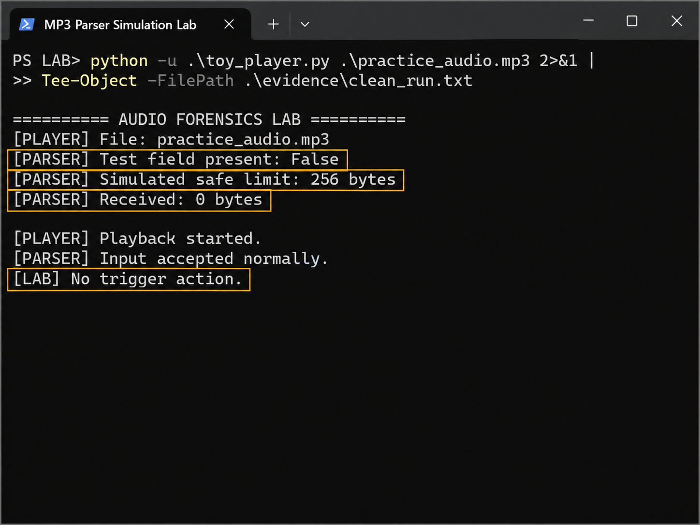
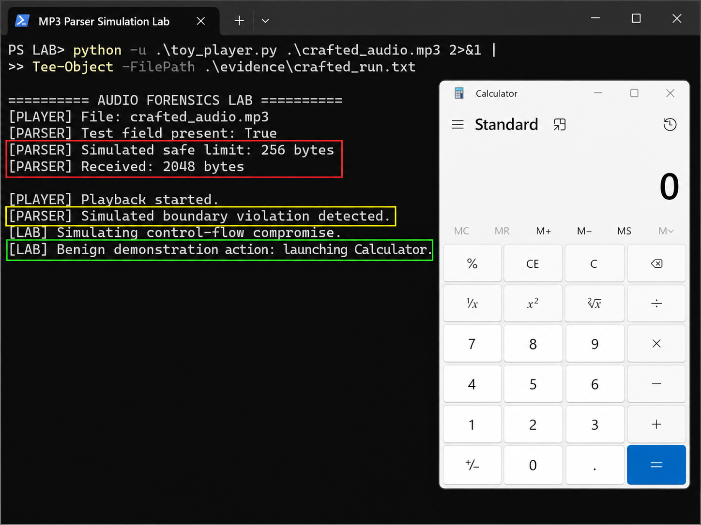
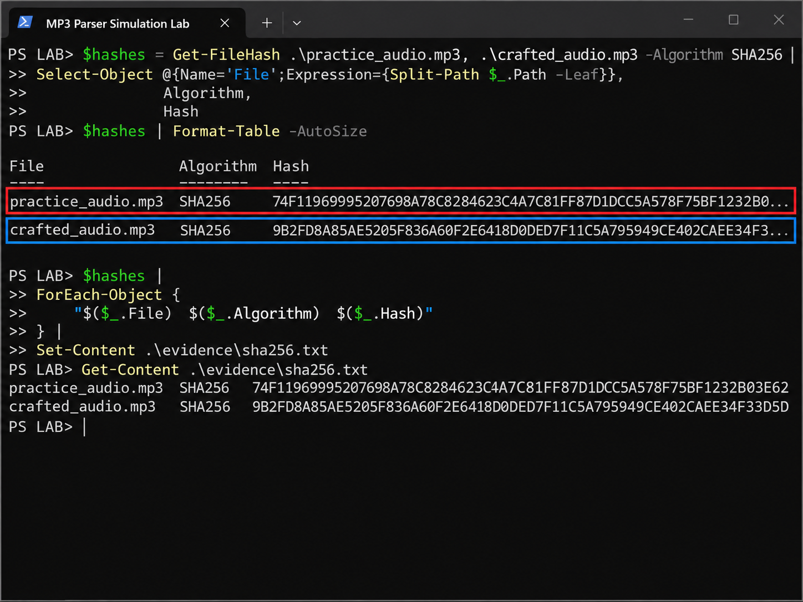
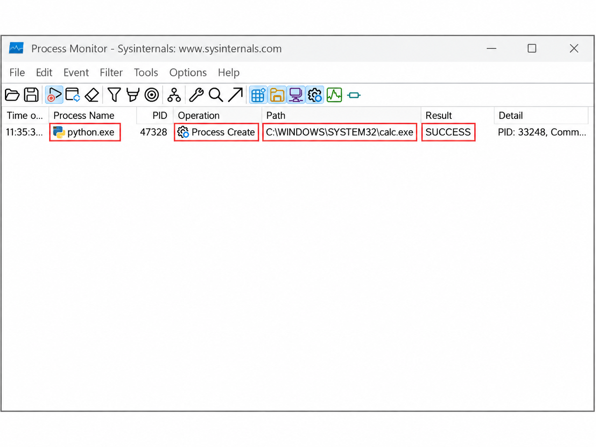
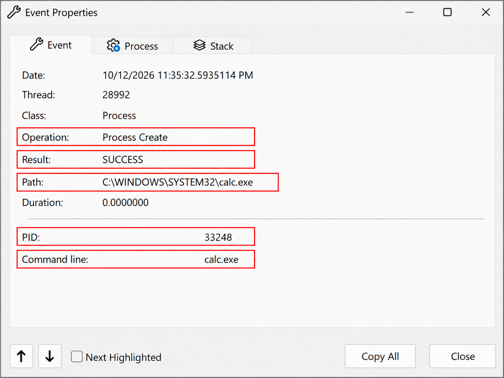
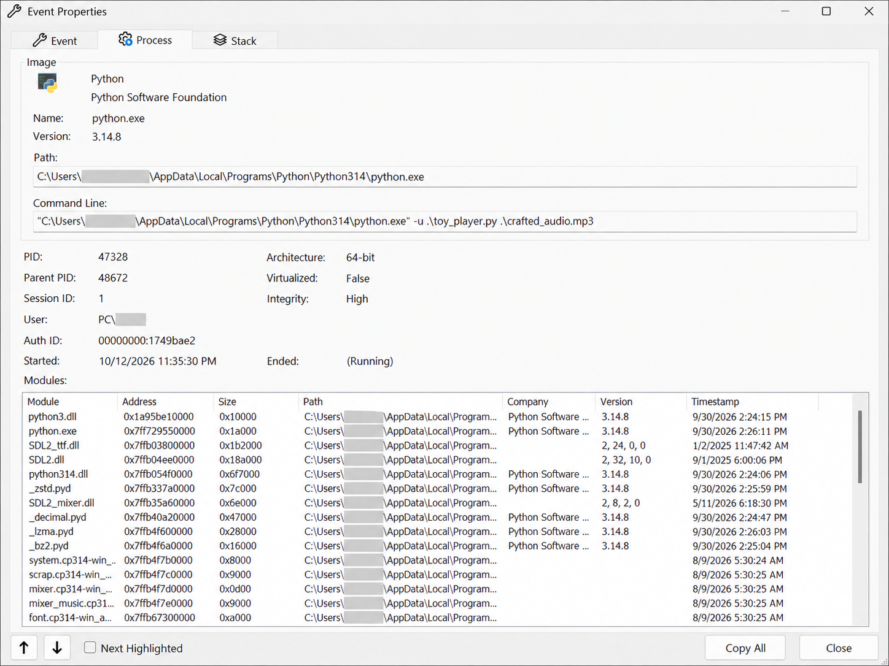

# MP3 Media-Parser Simulation Lab

## Overview

This project demonstrates a **controlled simulation of media-file-triggered application behavior** using MP3 metadata and a deliberately designed toy music player.

The lab compares two versions of the same MP3:

- `practice_audio.mp3` — clean control sample
- `crafted_audio.mp3` — same audio with a custom ID3 `TXXX` field named `LAB_PARSER_TEST`

The toy player defines a **simulated safe metadata limit of 256 bytes**. The crafted sample contains approximately **2048 bytes** in the custom test field. When that intentionally programmed threshold is exceeded, the application enters a controlled branch and launches **Windows Calculator (`calc.exe`)** as a benign demonstration action.

> **Important:** This is a simulation, not a real MP3 exploit. It does not exploit VLC, Windows Media Player, Windows, or the MP3 format itself.

---

## Research Question

**Can an MP3 cause code execution?**

Not by itself.

An MP3 is data. Code execution occurs only when software interprets that data in a way that changes application control flow. This project models that distinction in a safe, intentionally designed environment.

---

## Test Architecture

```text
Clean MP3
   |
   v
ID3 metadata parser
   |
   v
LAB_PARSER_TEST absent
   |
   v
0 bytes received
   |
   v
Normal playback
   |
   v
No trigger action
```

```text
Crafted MP3
   |
   v
ID3 metadata parser
   |
   v
LAB_PARSER_TEST present
   |
   v
2048-byte test input
   |
   v
Simulated 256-byte boundary exceeded
   |
   v
Controlled application branch
   |
   v
calc.exe
```

---

## Results

### Clean Control

The clean sample produced:

```text
[PARSER] Test field present: False
[PARSER] Simulated safe limit: 256 bytes
[PARSER] Received: 0 bytes
[PARSER] Input accepted normally.
[LAB] No trigger action.
```

Evidence:



### Crafted Sample

The crafted sample produced:

```text
[PARSER] Test field present: True
[PARSER] Simulated safe limit: 256 bytes
[PARSER] Received: 2048 bytes
[PARSER] Simulated boundary violation detected.
[LAB] Simulating control-flow compromise.
[LAB] Benign demonstration action: launching Calculator.
```

Evidence:



---

## Forensic Validation

### SHA-256

The two artifacts have different SHA-256 values:

| File | SHA-256 |
|---|---|
| `practice_audio.mp3` | `74F11969995207698A78C8284623C4A7C81FF87D1DCC5A578F75BF1232B03E62` |
| `crafted_audio.mp3` | `9B2FD8A85AE5205F836A60F2E6418D0DED7F11C5A795949CE402CAEE34F33D5D` |

Evidence:



### Process Monitor

Microsoft Sysinternals Process Monitor recorded:

```text
Process Name: python.exe
Operation:    Process Create
Path:         C:\WINDOWS\SYSTEM32\calc.exe
Result:       SUCCESS
```

Evidence:



Detailed event evidence:



A redacted process-details screenshot is also included for supplementary context:



---

## Repository Structure

```text
mp3-parser-simulation/
|
|-- README.md
|-- requirements.txt
|-- .gitignore
|
|-- src/
|   |-- toy_player.py
|   `-- make_crafted_mp3.py
|
|-- samples/
|   |-- practice_audio.mp3
|   `-- crafted_audio.mp3
|
|-- evidence/
|   |-- 01_clean_control.png
|   |-- 02_executable_demonstration.png
|   |-- 03_sha256_hashes.png
|   |-- 04_procmon_process_create.png
|   |-- 05_procmon_event_details.png
|   |-- 06_process_details_redacted.png
|   |-- clean_run.txt
|   |-- crafted_run.txt
|   |-- sha256.txt
|   |-- crafted_execution_procmon.CSV
|   `-- crafted_execution_procmon.PML
|
`-- docs/
    |-- methodology.md
    |-- architecture.md
    `-- limitations.md
```

---

## Requirements

- Windows 11
- Python 3
- `pygame-ce`
- `mutagen`

Install dependencies:

```powershell
python -m pip install -r requirements.txt
```

---

## Reproduction

From the repository root:

### Clean control

```powershell
python -u .\src\toy_player.py .\samples\practice_audio.mp3
```

Expected result: normal playback and no trigger action.

### Crafted sample

```powershell
python -u .\src\toy_player.py .\samples\crafted_audio.mp3
```

Expected result: the simulated parser threshold is exceeded and Calculator is launched as the controlled benign demonstration action.

---

## Evidence Handling

The PNG files in `evidence/` are **presentation-edited copies** used for public documentation. They may include cropping, annotation, or privacy redaction.

The raw machine-generated evidence is preserved separately through:

- `clean_run.txt`
- `crafted_run.txt`
- `sha256.txt`
- `crafted_execution_procmon.CSV`
- `crafted_execution_procmon.PML`

Do not treat the annotated screenshots as substitutes for the underlying raw logs.

---

## Security and Ethical Scope

This project intentionally avoids weaponization.

It contains:

- no shellcode
- no real memory corruption
- no persistence
- no credential theft
- no remote connection
- no command-and-control functionality
- no malicious payload
- no exploit against a production media player

The behavior is intentionally programmed into the toy application for educational and forensic demonstration purposes.

---

## Key Takeaway

A file extension does not determine whether code executes.

The important security boundary is the software that parses and interprets the file.

This project demonstrates that concept through a controlled chain:

```text
untrusted file input
        ->
metadata parsing
        ->
application logic
        ->
controlled process execution
```

---

## Disclaimer

This repository is for educational and defensive security research only.

It models the mechanics of media-parser risk without exploiting a real vulnerability.
